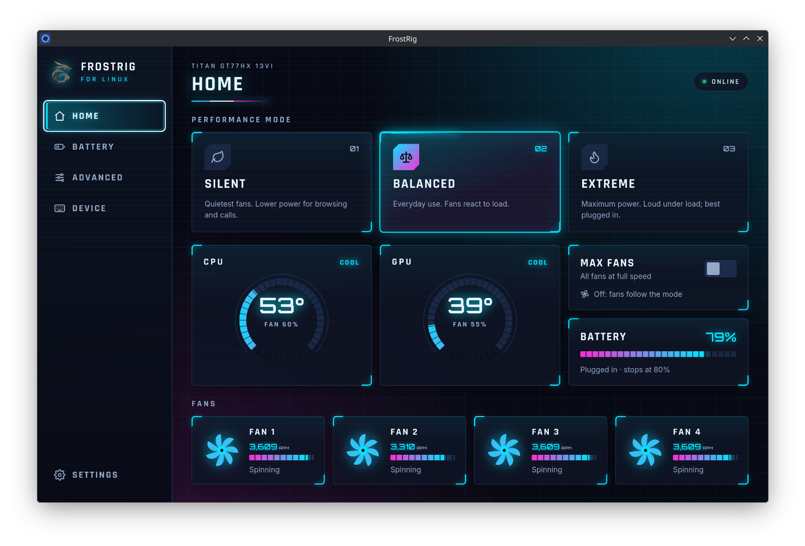
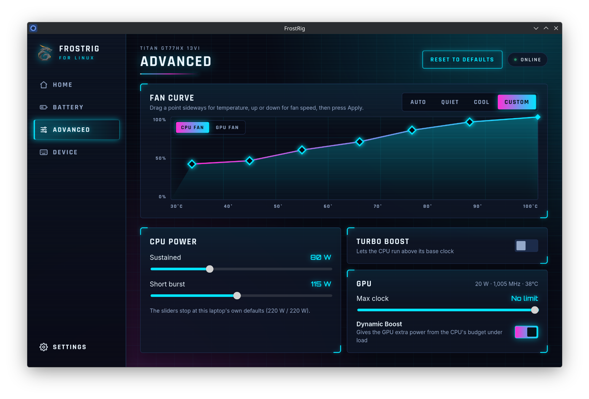
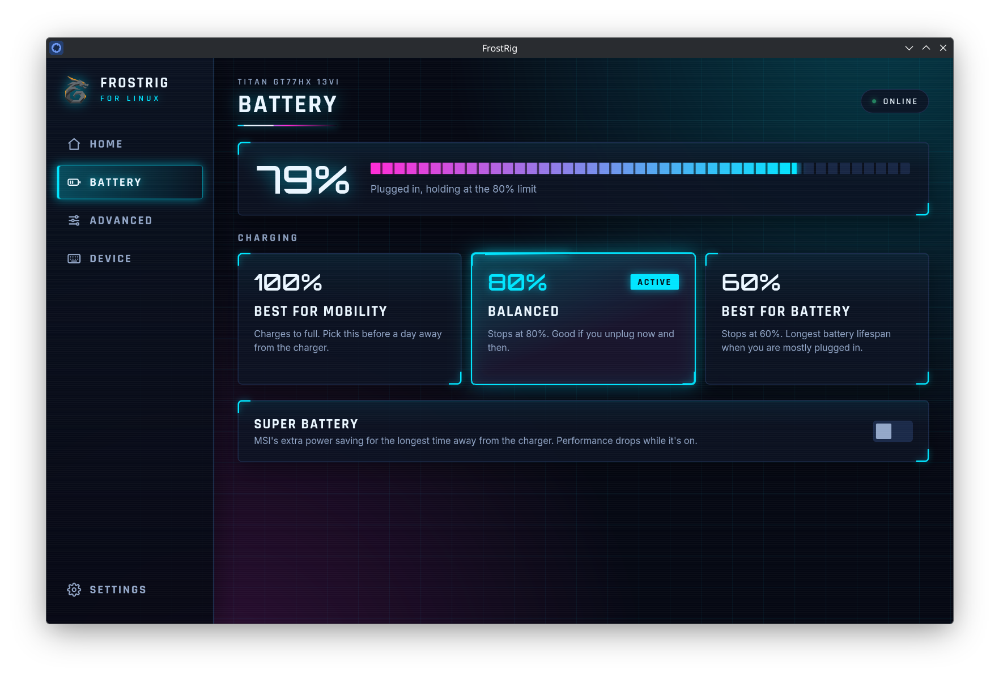
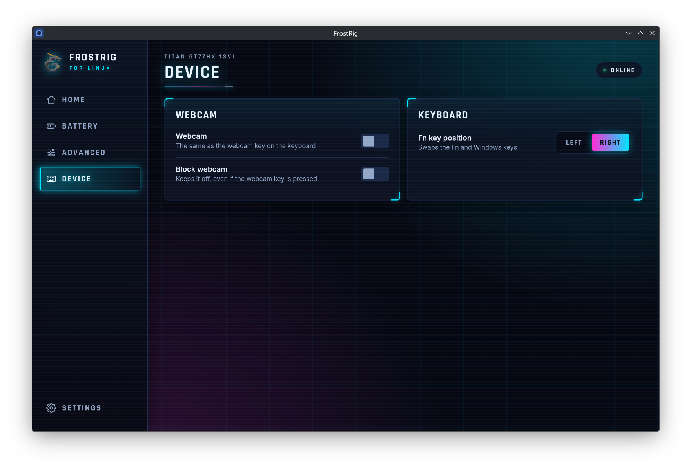
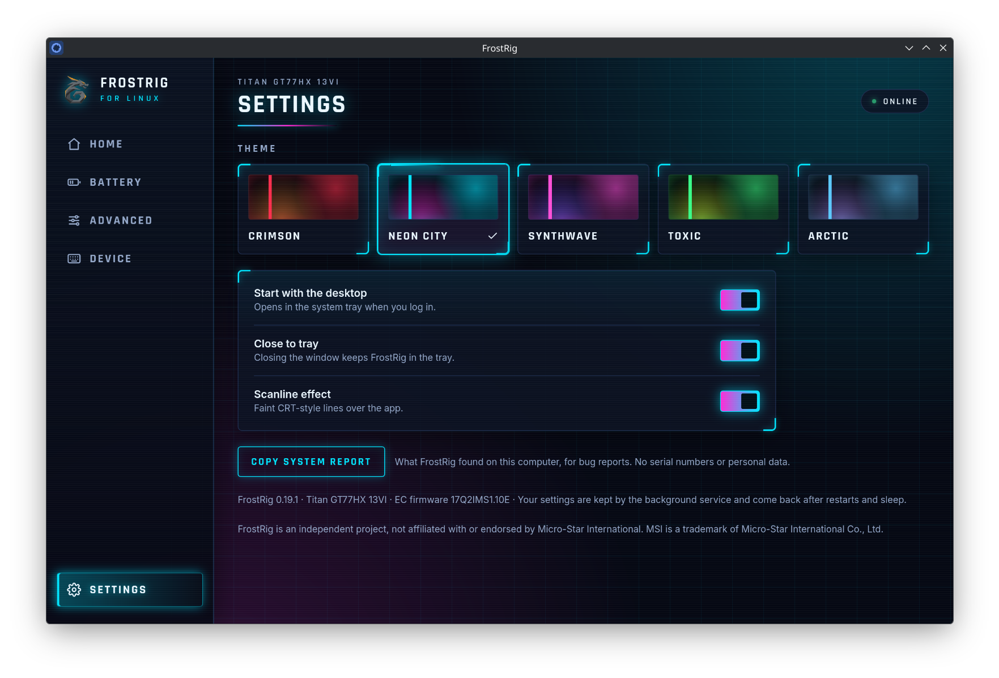

<p align="center"></p>

# FrostRig

FrostRig started specifically with MSI laptops in mind. More specifically, my own.
I have been one of those individuals that have been toying with the idea of abandoning
the Microsoft ship... Countless formats later because of my inherent ability to adhere
to the universal rule of break before make, I had a CachyOS setup running headless over
Sunshine and Moonlight with the use of an HDMI Dummy plug to force my screen availability,
but I found myself looking for an easy and straightforward way to manage the system performance
and cooling, because I cut up my wife's rather expensive television console unit with fan holes
in the rear panel, installed some bright RGB fans to create a circulating airflow, and wanted to
ensure I can maximize cooling while keeping the cabinet door closed. I desperately wanted something
similar to what MSI Dragon Center and other software offer on Windows. I used some AI insights
and had many a piece of python scriptures all around the machine, making small steps towards
controlling the system. Shortly after this, I found a piece of software called MControlCenter
which scratched the itch for a little bit, albeit, I felt I wanted more. (No disrespect to the
creator and a big thank you - check out this tool https://github.com/MControlSuite/MControlCenter).
With the rise of some very impressive vibe-coded software popping up everywhere, I decided to have
a go at it. I am in no means nearly as experienced, nor do I have the expertise of some of the great
developers out there, but I really wanted to bring something to the Linux Universe in an area where I felt some
systems (maybe even people) got left behind. I am only now starting to dig through the code,
learning what each little bit does, how it interacts with the system. I am releasing this project
purely as a passion project for some folks that may feel left behind in the leap to a better universe,
or hesitant to make the jump because of their fears of needing software for their systems. Or maybe
just for that one guy that needs to gain a few more FPS, either way, my intention is not to draw
criticism, or cause harm in any way. I am releasing this in the hope that it gets some attention and
draw expertise from the great developers out there, so that it may evolve, offer insight into my approach
and ideas, and hopefully get crafted into something with a human touch.

Although it started with MSI machines in mind, I tried to introduce mechanisms that will detect what
each machine supports and only show that, other laptops and desktops also get whatever standard Linux
controls they have. Pick a performance mode, turn on Max Fans, set a battery charge limit, and change fan curves,
in one click each, with no password prompts.

- **Home:** Silent / Balanced / Performance / Extreme, Max Fans, live CPU and GPU temperatures
- **Battery:** charge to 100%, 80% or 60%
- **Advanced:** fan curve (Auto, Quiet, Cool, Custom), CPU power limits, Turbo Boost, GPU clock limit, NVIDIA Dynamic Boost
- **Device:** webcam on/off and block, Fn/Windows key swap, keyboard backlight
- **Settings:** five themes, start with the desktop, close to tray

Your choices stick: they come back after a restart and after sleep.

<p align="center">
  
</p>

| Advanced | Battery |
|---|---|
|  |  |
| **Device** | **Settings** |
|  |  |

## How it works

```
FrostRig app (your user)  ──D-Bus──▶  frostrigd (root, systemd)  ──▶  msi-ec, RAPL, cpufreq, battery
```

- **frostrigd** is a small background service, started at boot. It is the only part that
  changes hardware. Before each change it checks the value is allowed on this laptop; after,
  it reads the value back. If writing a fan curve fails, it puts the previous one back.
- The **app** runs as you and never touches hardware. It asks the service over D-Bus.
- **polkit** lets the person sitting at the laptop make changes without a password, the same
  way KDE's power profiles work. Someone connected remotely (e.g. over SSH) has to authenticate as an admin.

### What's supported where

FrostRig probes the actual machine at startup and when a GPU wakes. A control only appears after
the driver has accepted a harmless test write of the value it already has.

| Feature | Comes from | Works on |
|---|---|---|
| Performance modes | msi-ec on MSI laptops; otherwise power-profiles-daemon (or tuned-ppd) if it's running; otherwise the kernel's `platform_profile` | MSI, ThinkPad, ASUS, Dell, HP, Lenovo Legion/IdeaPad and many more. Only the modes a machine offers are shown |
| Max Fans | msi-ec's `cooler_boost` | MSI laptops |
| Super Battery | msi-ec's `super_battery` | MSI laptops that have it |
| Webcam on/off and block | msi-ec's `webcam`, `webcam_block` | MSI laptops |
| Fn / Windows key swap | msi-ec's `fn_key` | MSI laptops |
| Keyboard backlight | `/sys/class/leds/*::kbd_backlight` (msi-ec first) | Single-colour backlights. RGB keyboards aren't controlled |
| Battery charge limit (60/80/100%) | `charge_control_end_threshold` | Most laptops whose driver exposes it. Hidden on desktops |
| Turbo Boost | `intel_pstate` or cpufreq `boost` | Intel, and AMD with `amd-pstate` |
| CPU power limits | Intel RAPL | Intel CPUs. Sliders stop at the machine's own defaults |
| CPU / GPU temperatures | msi-ec on MSI; otherwise `coretemp`, `k10temp`/`zenpower`, ACPI, and each GPU's own sensor | Most machines |
| NVIDIA GPU | `nvidia-smi` | Clock limit; power limit where the firmware allows it (most desktops, few laptops); Dynamic Boost when `nvidia-powerd` is installed |
| AMD Radeon GPU | amdgpu sysfs | Power limit (between the driver's own min and max); clock mode Auto / Power saving / Maximum |
| Intel GPU | i915 / xe sysfs | Max clock on built-in and Arc GPUs; power limit on Arc (up to its rated maximum) |
| Fan curves | raw EC access | **Titan GT77HX 13VI (EC firmware 17Q2IMS1.10E) out of the box.** Other MSI laptops whose EC has MSI's usual fan-table layout can unlock them with a one-time fan test (below). Anything else is never written to |

Built-in GPUs only get controls when there's no dedicated GPU. A GPU that's asleep (hybrid laptops)
is never woken just to read it, and its settings are put back each time it wakes.

**Help support more hardware:** in Settings, press **Copy system report** and paste it into a bug report.
It lists what FrostRig detected (no serial numbers or personal data).

On the GT77, the service loads the `ec_sys` kernel module with write support by itself. It does
this only on that exact laptop and firmware.

The first time it runs, the service records the laptop's factory fan curve, power limits and
Turbo setting in `/var/lib/frostrig/factory`. **Reset to defaults** goes back to these, and the
Quiet and Cool fan curves are calculated from them. No hard-coded fan curves ship with the app.

## Install (CachyOS / Arch)

FrostRig has two parts: a small background service that talks to the hardware, and the app you
open. Both are in one package. It's built for Arch-based distros (CachyOS, EndeavourOS,
Manjaro, Arch).

### 1. Install the MSI driver (MSI laptops)

Performance modes, Max Fans, fan curves, the battery limit and the other MSI features use the
community [msi-ec](https://github.com/BeardOverflow/msi-ec) kernel driver. Install it with the
headers for your kernel (CachyOS ships `paru`):

```fish
paru -S msi-ec-dkms-git linux-cachyos-headers
```

On stock Arch, use `linux-headers` (or `linux-lts-headers`, etc.) instead of `linux-cachyos-headers`.
**Reboot**, then check that the driver loaded:

```fish
ls /sys/devices/platform/msi-ec
```

If that folder exists, you're set. If not, run `sudo dmesg | grep msi_ec`: a message saying your
firmware isn't supported means msi-ec doesn't know your model yet. FrostRig still runs without it,
with fewer features (see [What's supported where](#whats-supported-where)).

### 2. Install FrostRig

Download the package from the [latest release](https://github.com/reinodl/frostrig/releases/latest)
and install it. Change the version number to the latest one:

```fish
cd ~/Downloads
curl -LO https://github.com/reinodl/frostrig/releases/download/v0.19.1/frostrig-0.19.1-1-x86_64.pkg.tar.zst
sudo pacman -U frostrig-0.19.1-1-x86_64.pkg.tar.zst
```

(Or download the `.pkg.tar.zst` file from the release page in your browser and run the last line.)
pacman installs the dependencies, and the FrostRig service starts straight away and at every boot.
To build the package yourself instead, see [Build and install](#build-and-install).

### 3. Open it

Open **FrostRig** from your app menu. There are no passwords, prompts or extra setup: changes
apply as you make them. Closing the window keeps FrostRig in the system tray; turn on
**Start with your computer** in Settings to have it there after you log in.

On first start, the service records your laptop's factory fan curves and power limits.
**Reset to defaults** always goes back to these.

### Updating

Install the new release the same way, with the new version number. Your settings are kept.

### Uninstalling

```fish
sudo pacman -R frostrig
```

This stops and removes the service. Settings and the recorded factory values stay in
`/var/lib/frostrig`; delete that folder too for a clean removal:

```fish
sudo rm -r /var/lib/frostrig
```

### Something not working?

- Check the service is running: `systemctl status frostrigd`
- See what it logged: `journalctl -u frostrigd -b --no-pager | tail -n 50`
- In FrostRig, open **Settings** and press **Copy system report**, then
  [open an issue](https://github.com/reinodl/frostrig/issues/new/choose) and paste it in.
  The report lists your hardware only: no serial numbers or personal data.

### Build and install

```fish
cd packaging
makepkg -si
```

The package installs the app, the service, and the D-Bus and polkit files. It enables and starts
the service. Then open **FrostRig** from your app launcher.

### Development

```fish
npm install
cargo test -p frostrig-core   # hardware logic tests, run against a fake sysfs tree
npm run check                    # Svelte/TypeScript checks
npm run dev                      # the app, talking to the installed service
```

`npm run dev` needs the service installed (`makepkg -si` once). If you change the service,
rebuild and reinstall the package, or run `cargo build -p frostrigd` and copy
`target/debug/frostrigd` to `/usr/lib/frostrig/` and restart it.

Service logs: `journalctl -u frostrigd`

## Project layout

| Folder | What |
|---|---|
| `core/` | Hardware logic: detection, checks, apply with read-back, settings, factory values. No dependencies; fully unit-tested |
| `daemon/` | `frostrigd`: D-Bus interface, polkit check, restore at boot and after sleep |
| `src-tauri/` | Desktop app shell: D-Bus client, tray, autostart |
| `src/` | The interface (Svelte) |
| `packaging/` | systemd unit, D-Bus and polkit files, PKGBUILD, migration script |

## D-Bus interface

`io.github.frostrig.Daemon` at `/io/github/frostrig/Daemon`, interface `io.github.frostrig.Daemon1`:

| Method | Arguments |
|---|---|
| `GetStatus` | → JSON string (open to everyone) |
| `SetMode` | `s` silent / balanced / performance / extreme |
| `SetMaxFans` | `b` |
| `SetChargeLimit` | `y` 60, 80 or 100 |
| `SetTurbo` | `b` |
| `SetCpuPower` | `u` sustained W, `u` burst W |
| `SetFanPreset` | `s` auto / quiet / cool / custom |
| `SetCustomFanCurve` | `ay` CPU temps, `ay` CPU speeds, `ay` GPU temps, `ay` GPU speeds (7 points each) |
| `SetSuperBattery`, `SetWebcam`, `SetWebcamBlock` | `b` |
| `SetFnKey` | `s` left / right |
| `SetKeyboardBacklight` | `u` level, 0 = off |
| `GetReport` | → plain-text detection summary (open to everyone) |
| `SetGpuClockLimit` | `s` GPU id (PCI address from status), `u` MHz, 0 = no limit |
| `SetGpuPowerLimit` | `s` GPU id, `u` watts, 0 = driver default |
| `SetGpuLevel` | `s` GPU id, `s` auto / low / high (AMD) |
| `SetDynamicBoost` | `b` |
| `ResetAdvanced` | none |

So you can script it, e.g. `busctl call io.github.frostrig.Daemon /io/github/frostrig/Daemon io.github.frostrig.Daemon1 SetMode s performance`.

## Fan curves on other MSI laptops

Many MSI laptops keep their fan curves at the same place in the embedded controller: 7 temperature
points and 7 fan speeds for the CPU at 0x6A/0x72 and for the GPU at 0x82/0x8A. Some thinner models
have only the CPU curve. FrostRig can't know for sure from the model name, so it checks on your laptop:

1. **Read only:** if msi-ec offers the advanced fan mode and the CPU table looks like a fan curve
   (temperatures rising, speeds never falling), Advanced shows **Run fan test**. Nothing is written
   until you press it.
2. **The test** (under a minute, while idle) raises the CPU curve to 100%, checks msi-ec's fan speed
   goes up, puts the table back, then does the same for the GPU curve. It only ever makes fans
   faster, and the original tables always go back, including on Cancel or failure.
3. **Result:** if the CPU fan responds, fan curves turn on, recorded for that exact EC firmware.
   If the GPU table doesn't respond, the laptop is treated as single-curve: one curve drives every
   fan and the GPU block is never written. A BIOS/EC update means running the test again.

If the test fails, or your laptop works differently, **Settings → Copy system report** includes a dump
of the EC fan area (0x60–0x9F). Please open an issue with it.

## Disclaimer

FrostRig is an independent project, not affiliated with or endorsed by Micro-Star International.
MSI is a trademark of Micro-Star International Co., Ltd. Names of MSI laptops and features appear only
to say which hardware FrostRig works with.

Changing fan curves and power limits is at your own risk. FrostRig checks every change and refuses
unverified hardware, but it comes with no warranty (see LICENSE).
